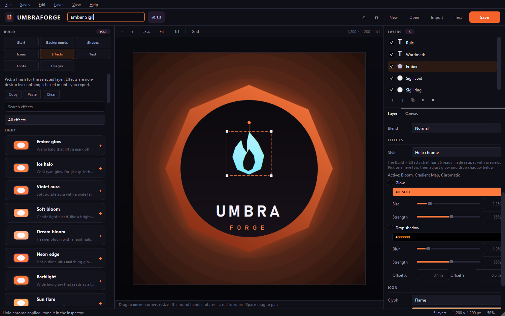
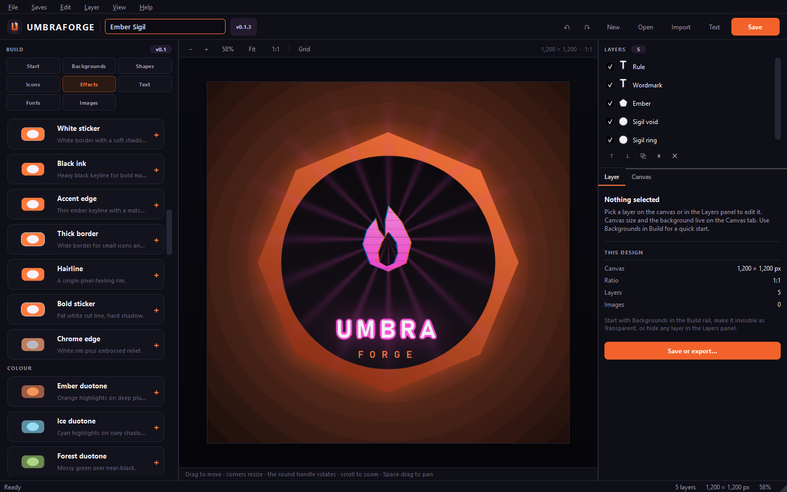
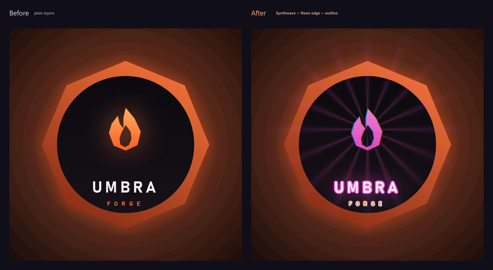
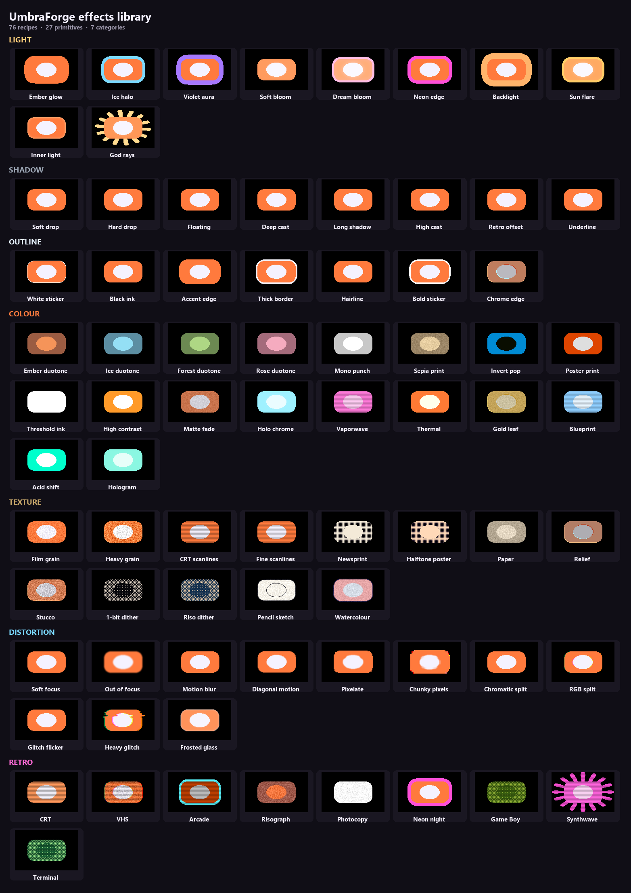

# UmbraForge

**Make the dark yours.**

UmbraForge is a desktop studio for building layered images and original
emblems: profile pictures, 4K wallpapers, phone art, square posts, banners,
posters and anything in between. Every design is editable - nothing is
flattened - and projects can be saved, reopened and resized without losing the
composition.

A [WinterGate Intelligence Collective](https://wintergate.org) tool by
AnonCatalyst. WIC is an independent, privacy-first collective and the
originating author of this project. UmbraForge is its official project; the MIT
licence covers the code, not the WinterGate, UmbraForge or VoiceForge names or
logos. Forks are welcome but must use their own name - see
[TRADEMARKS.md](TRADEMARKS.md).

---

## What it does

- **Preset canvases** for profile pictures, square posts, desktop 4K, wide
  16:9, mobile wallpaper, banners, posters, stories, link cards and custom
  sizes. Layers are stored as fractions of the canvas, so switching preset
  reflows the art instead of cropping it.
- **Layered emblem building** with 141 vector shapes, 157 SVG icons, **885
  colour emoji across nine categories**, 28 type styles, a large installed-font
  shelf, images, effects, blend modes and stacking controls. Any shape, icon or
  emoji can be swapped in place from the Build rail, the inspector or the
  right-click menu. Build crests, badges and social-club emblems from parts.
- **A searchable emoji library** with Smileys, People, Nature, Food, Activity,
  Travel, Objects, Symbols and Flags shelves, keyword search, recents, a
  **Surprise me** button and a full-screen picker. Emoji are editable layers:
  move, resize, rotate, tint, blend, mask and add effects like anything else.
- **37 editable background presets** across ten categories for instant starts -
  forge-lit violet, ember haze, starfield, ocean grid, hex mesh, aurora waves,
  forest floor, risograph, synth sunset, scanlines and more - applied as
  ordinary `design.background` values you can still recolour, repattern or
  switch to transparent in the Canvas tab, with preset, colour-swap and
  randomise controls right in the inspector.
- **36 editable templates** grouped by category, from wallpapers, social cards
  and posters to a whole **Meme** shelf (top/bottom, no/yes, expanding brain,
  deep fried, galaxy brain) and a **Propaganda** shelf (Rise, Unite, Victory,
  Attention, Our Voice). Every part of a template is a normal layer.
- **A 43-preset Overlays library** that sits above the whole canvas: film grain,
  light leaks, lens flares, bokeh, holo and prism washes, rain, snow, embers,
  sparkles, confetti, halftone, grids, scanlines, VHS bars, frames, corner
  marks, paper and vignettes. Overlays are non-destructive and editable from the
  Canvas tab, where a **mixer** enables any of the 23 primitives and tunes its
  opacity, colour, angle, size or count independently. A cleared stack is a
  pixel-identical no-op.
- **Background removal** in three flavours:
  - *Auto* samples the border and flood-fills only connected pixels, so a
    subject that shares a colour with the background survives.
  - *Chroma key* removes one colour anywhere, with soft edges and despill.
  - *AI cutout* is optional, local and never uploads anything; it appears when
    `rembg` is installed.
- **Image editing** with a non-destructive adjustment stack, fit modes and
  shape masks.
- **A 96-recipe effects library** across Light, Shadow, Outline, Colour,
  Texture, Distortion, Sketch and Retro, built on 37 tunable primitives (glow,
  bloom, god rays, long shadow, outline, blur, zoom blur, tilt shift, swirl,
  wave, bulge, kaleidoscope, pixelate, duotone, gradient map, halftone, dither,
  edge sketch, charcoal, comic ink, sharpen, solarize, hue shift, chromatic
  split, glitch, scanlines, grain and more). Each recipe has a rendered preview,
  effects live in a layer stack and are never baked in until you export, and
  **Copy**/**Paste** carries a tuned style from one layer to another.
- **One Save flow** for PNG, JPEG, WebP, BMP, TIFF, Windows `.ico`, macOS
  `.icns`, a complete web-icon kit and the editable project. PNG is the default;
  sizes and compression adapt to the machine's safe memory budget.
- **Portable projects**: `.umbra` is a single JSON document with every image
  embedded. Reopen it to keep editing, merge its layers into another design, or
  hand it to UmbraForge by double-clicking it.
- **Snapshot undo/redo** that treats a slider drag as one step, not fifty.
- Dark theme throughout, with a drawn app mark (no external icon files
  required).

## See it

The Effects shelf, with search, categories and a rendered preview for every
recipe:



Recipes are non-destructive and can be swapped, tuned, copied to other layers
or cleared at any time:



Before and after - plain layers on the left, Synthwave + Neon edge + hairline
outline on the right:



The whole library at a glance:



## Requirements

- Python 3.10 or newer
- Windows 10/11, macOS or Linux with a desktop Qt platform
- `PySide6`, `Pillow`, `numpy`

## Install (Windows)

Download the latest release from the
[releases page](https://github.com/WinterGate-IC/UmbraForge/releases). Inside
it you will find:

| Item | What it is |
|---|---|
| `UmbraForge-0.1.5-windows-x64.zip` | **Main package** - portable app with its own Python runtime. Unzip and double-click `UmbraForge.exe`. No installation needed. |
| `UmbraForge-Setup-0.1.5.exe` | **Installer** - fully offline. It contains the same package, copies it to a folder you choose and records the install. |
| `README.md` | This file. |
| `LICENSE` | MIT licence and WinterGate notices. |
| `THIRD_PARTY_NOTICES.md` | Licences for the libraries bundled in the package. |

The installer needs **no Python, no pip and no internet connection**. Run it
from anywhere, including after copying it to another drive or machine. The
default program folder is:

```
%LOCALAPPDATA%\Programs\UmbraForge
```

Editable saves live separately in `%USERPROFILE%\Documents\UmbraForge`, so
reinstalling or updating the app never touches your projects. Set
`UMBRAFORGE_SAVES` to use a different folder.

### Verify the download

Releases are **not code-signed yet**, so Windows SmartScreen may show
"Unknown publisher" the first time you run the installer or the app. That is
expected: trusted signing certificates are issued by CAs to verified
organizations or individuals, and WIC operates as an independent, privacy-first
collective rather than a conventional company. See
[CODE_SIGNING.md](CODE_SIGNING.md) for the status and the path to signed builds.

Verify the bundle before running it:

```powershell
Get-FileHash .\UmbraForge-<version>.zip -Algorithm SHA256
```

The digest must match the one in the release notes and in the release's
`SHA256SUMS.txt`. If it does not, do not run the file; report it through
[SECURITY.md](SECURITY.md).

### From source

```powershell
cd umbraforge
python -m venv .venv
.venv\Scripts\python.exe -m pip install -r requirements.txt
```

Optional AI background removal (large download, fully offline afterwards):

```powershell
.venv\Scripts\python.exe -m pip install -r requirements-ai.txt
```

## Run

From the project folder:

```powershell
run.cmd
```

or

```powershell
.venv\Scripts\python.exe desktop.py
```

Double-clicking `UmbraForge.pyw` works too. To open a project straight away:

```powershell
.venv\Scripts\python.exe desktop.py path\to\design.umbra
```

After an editable install (`pip install -e .`) the `umbraforge` command and
`python -m umbraforge` are also available.

## Quick start

1. The app opens on the **Ember Sigil** template, already editable. Drag it
   around, or start fresh with **New design**.
2. Choose a canvas preset and either a blank sheet or a template.
3. Add parts from the left rail: **Start** (templates, projects and blank),
   **Backgrounds** (37 ready-made presets with live previews), **Overlays**,
   **Shapes**, **Icons**, **Emoji**, **Effects**, **Text**, **Fonts** and
   **Images**. The **Text** tab has an **Add text** button (also on the top bar,
   in the **Edit** menu, and on the canvas right-click menu); **Ctrl+T** works
   anywhere. **Emoji** adds a colour glyph; the top-bar **Emoji** button and
   **Ctrl+Shift+E** open the full picker.
4. Select a layer on the canvas or in the layer stack to edit it in the right
   rail: geometry, fill, effects, blend mode, text, emoji tint, image
   adjustments, masks and background removal. Shapes, icons and emoji also have
   a **Browse** button for swapping the art without losing position, size,
   rotation or effects.
5. Use the **Canvas** tab in the inspector to change size, background preset,
   gradient, pattern, vignette, overlay recipe and individual overlay
   components.
6. Press **Save** when it looks right. The same dialog writes a flat image
   (PNG first) or an editable `.umbra` project. By default a flat save also
   writes the paired `.umbra` beside it, so every save can be reopened.
7. Close the app and come back later: **Saves > Continue where you left off**
   reopens your latest project. The same list is on the Start tab and under
   **File > Open recent**.

### Canvas controls

| Action | How |
| --- | --- |
| Move a layer | Drag it |
| Resize | Drag a corner handle; hold **Shift** to keep proportions |
| Rotate | Drag the round handle; hold **Shift** to snap to 15° |
| Nudge | Arrow keys (hold **Shift** for ten pixels) |
| Zoom | Scroll wheel |
| Pan | Middle-drag or **Space** + drag |
| Fit / actual size | **Ctrl+0** / **Ctrl+1** |
| Grid | **Ctrl+G** |
| Snap | Automatic to canvas centre and other layers, with guides |
| Add text | **Ctrl+T**, the **Text** button, **Edit > Add text**, or the empty-canvas right-click menu |
| Edit text | **F2**, **Edit > Edit text**, the canvas right-click menu, or double-click a text layer |
| Add emoji | **Ctrl+Shift+E**, the **Emoji** button, **Edit > Add emoji**, or the empty-canvas right-click menu |
| Swap shape / icon / emoji | Select the layer, then use **Change shape/icon/emoji…** in the right-click menu, **Browse** in the inspector, or tick **Swap selected** in the Build rail |

### Shortcuts

| Shortcut | Action |
| --- | --- |
| **Ctrl+N** | New design |
| **Ctrl+O** | Open project |
| **Ctrl+S** / **Ctrl+Shift+S** | Save / Save as (same unified dialog) |
| **Ctrl+Alt+S** | Save an editable `.umbra` copy |
| **Ctrl+I** | Import image |
| **Ctrl+Shift+I** | Import layers from another project |
| **Ctrl+T** | Add a text layer |
| **Ctrl+Shift+E** | Open the emoji picker and add the chosen emoji |
| **F2** | Edit the selected text layer |
| **Ctrl+Z** / **Ctrl+Shift+Z** | Undo / Redo |
| **Ctrl+D** | Duplicate layer |
| **Delete** | Delete layer |
| **Ctrl+L** | Lock / unlock layer |
| **Ctrl+[** / **Ctrl+]** | Send backward / bring forward |
| **Ctrl+Shift+[** / **Ctrl+Shift+]** | Send to back / bring to front |
| **Ctrl+Shift+C** | Centre layer |
| **Ctrl+Alt+C** / **Ctrl+Alt+V** | Copy / paste a layer's effect style |
| **F1** | Quick guide |

## Background removal notes

The offline engines are deliberately dependency-light: NumPy and Pillow only,
no OpenCV or SciPy.

- **Auto** is the right default for product shots, portraits on a plain wall
  and logos on a flat colour. The flood fill starts at the image edge, so a
  dark eye in a dark-background portrait is not punched out unless it touches
  the border colour region.
- **Chroma key** is for green/blue screens and flat-colour graphics. Use
  **Sample** to grab the border colour, then lower **Tolerance** if the subject
  is being eaten.
- **Feather** softens the matte, **Shrink** pulls it in (negative grows it),
  and **Despill** (built into the chroma path) removes colour fringes.
- **AI cutout** runs `rembg` locally through `onnxruntime`. The first run
  downloads the model; after that it works offline. It is only used when you
  pick it.

Cutouts replace the layer's image with a new embedded asset; the original stays
in the project as `original_asset_id`, and undo restores it.

## Project files

`.umbra` is UmbraForge's own editable project container - the same role a
`.psd` or `.kra` plays in other studios. It is not a standard image format and
other apps cannot open it, but UmbraForge can return to it as often as you like.

- **Open project** (**Ctrl+O**) reopens every layer, image and setting.
- **Saves > Continue where you left off** reopens the most recent project in
  one click, with the last eight projects listed underneath and timestamps so
  you can tell versions apart.
- The **Start** tab shows a **Continue "<project>"** button plus the recent
  project list.
- **File > Open recent** does the same from the menu.
- **Save editable copy** (**Ctrl+Alt+S**) writes an `.umbra` even when the last
  save was a flat image.
- Saving a flat image writes the paired `.umbra` project by default. Uncheck
  **Also save an editable .umbra project** in the save dialog to export only
  the image.
- **Import project layers** (**Ctrl+Shift+I**) merges another project's layers
  and images into the current design; the background is left alone.
- Drag a `.umbra` onto the window to open it. Drag images in to add them as
  layers.
- Run **Register UmbraForge Files.cmd** once to associate `.umbra` with the app
  for the current Windows user. No administrator rights or installer required;
  remove it later with `register_file_types.ps1 -Remove`.

Flat formats (PNG, JPEG, WebP, BMP, TIFF, icons) are final. Keep an `.umbra`
copy when you want to come back and edit.

## Project format

`.umbra` is UTF-8 JSON and deliberately readable/repairable in a text editor:

```json
{
  "format": "umbraforge",
  "version": 1,
  "saved_with": "UmbraForge 0.1.5",
  "saved_at": "2026-10-26T12:34:56+00:00",
  "name": "Ember Sigil",
  "width": 1200,
  "height": 1200,
  "background": { "kind": "radial", "...": "..." },
  "layers": [
    { "kind": "shape", "x": 0.1, "y": 0.1, "w": 0.8, "h": 0.8 },
    { "kind": "emoji", "char": "\ud83d\udd25", "color": "#ff7a3d", "x": 0.4, "y": 0.4, "w": 0.2, "h": 0.2 }
  ],
  "assets": { "<sha1>": { "name": "photo.png", "mime": "image/png", "data": "..." } },
  "selected": "<layer id>"
}
```

Geometry is normalized (`0..1` of canvas width/height). Images are base64
encoded inside the document, so projects are self-contained. Emoji layers store
a Unicode `char` and an optional tint `color`, which keeps them tiny and lets
them use every transform and effect. Unknown layer kinds are skipped on load
rather than breaking the file. A newer format version is refused with a clear
message instead of being half-read. Saves are written atomically, so an
interrupted save cannot destroy the previous project.

## Tests

```powershell
.venv\Scripts\python.exe -m pytest
```

The suite covers presets, the document model, serialization, project headers,
project merging, assets, undo, vector geometry, fonts, type styles, the render
pipeline, templates, the emoji catalogue and glyph rendering, cutout maths,
raster and icon helpers, background presets and the Canvas editing controls,
rail thumbnails, paired project saves, the Saves menu, the unified save dialog
and an offscreen UI smoke test. Tests run headless with
`QT_QPA_PLATFORM=offscreen` (set automatically in `tests/conftest.py`).

## Build the release

```powershell
.venv\Scripts\python.exe -m pip install pyinstaller
.venv\Scripts\python.exe tools\build_release.py
```

The builder freezes the app, stages the portable package, builds the offline
Setup executable and writes one timestamped bundle to `releases/`. That bundle
contains the portable package zip, the Setup executable, `README.md`, `LICENSE`
and `THIRD_PARTY_NOTICES.md`.

## Licence

UmbraForge's own source is released under the MIT licence (see `LICENSE`).
Bundled third-party libraries keep their own licences; see
`THIRD_PARTY_NOTICES.md` and the `licenses/` folder. In particular, the
portable build bundles Qt for Python (PySide6), which is LGPL-3.0. The build
script and complete source are in this repository, so the bundled Qt libraries
can be replaced by rebuilding with a different Qt build.

The name and logo are not part of the MIT grant; see `TRADEMARKS.md`.
`OPEN_CORE.md` explains how a future paid add-on can exist without changing
this edition: everything in this repository stays free and complete.

## Project layout

```
umbraforge/
├─ desktop.py              source-checkout launcher
├─ UmbraForge.pyw          double-click launcher (no console)
├─ run.cmd                 Windows convenience launcher
├─ Register UmbraForge Files.cmd   optional .umbra association
├─ register_file_types.ps1         per-user file association script
├─ pyproject.toml          package metadata, entry point, pytest config
├─ requirements.txt        PySide6, Pillow, numpy
├─ requirements-ai.txt     optional rembg + onnxruntime
├─ LICENSE                 MIT licence
├─ THIRD_PARTY_NOTICES.md  bundled-library licences
├─ licenses/               full LGPL/GPL texts
├─ tools/build_release.py  package zip + installer builder
├─ releases/               local build output (not committed)
├─ src/umbraforge/
│  ├─ app.py               QApplication bootstrap and CLI
│  ├─ branding.py          WinterGate identity and the drawn app mark
│  ├─ theme.py             dark stylesheet and palette
│  ├─ presets.py           canvas sizes
│  ├─ layers.py            document model, assets, project files, undo
│  ├─ geometry.py          vector shapes and icons
│  ├─ icon_shelf.py        the SVG icon table
│  ├─ emojis.py            the categorised emoji catalogue and glyph cache
│  ├─ fonts.py             installed-font discovery and the font shelf
│  ├─ text_styles.py       named type recipes
│  ├─ imaging.py           Pillow/NumPy helpers and Qt bridges
│  ├─ effects.py           the effect primitives, presets and compositor
│  ├─ cutout.py            offline + optional AI background removal
│  ├─ quality.py           adaptive export, icons and web-icon kits
│  ├─ renderer.py          QPainter render pipeline
│  ├─ templates.py         the starter designs
│  └─ ui/                  main window, canvas, panels and dialogs
└─ tests/
```

## Status

Version 0.1.5 is the current Windows release. It ships as one timestamped
release bundle attached to the GitHub release and containing the portable
package, the offline per-user installer, `README.md`, `LICENSE` and
`THIRD_PARTY_NOTICES.md`, built by `tools/build_release.py`. The source tree
also runs directly (see **Install**).

What changed in 0.1.5:

- **Emoji** is a new Build section with **885 emoji in nine categories**,
  category filters, keyword search, a **Recent** shelf and a **Surprise me**
  button, plus a full picker on **Ctrl+Shift+E** and the top bar;
- emoji are real layers (`EmojiLayer`): native colour glyphs or a single-colour
  tint, with the same position, size, rotation, opacity, blend, flip and effect
  controls as every other layer;
- shapes, icons and emoji can now be **swapped in place**: tick **Swap
  selected** in the Build rail, use **Browse** in the inspector, or pick
  **Change shape/icon/emoji…** from the canvas right-click menu;
- the **Canvas** tab can apply any of the 37 background presets, swap the two
  background colours and randomise the background without opening the Build
  rail;
- a new **overlay mixer** enables and tunes any of the 23 overlay primitives -
  opacity, colour, angle, size, count, position and more - one component at a
  time, and switches the recipe to **Custom mix** automatically;
- the emoji catalogue stays Qt-free and renders through Pillow's colour-emoji
  path, so every glyph is crisp at any canvas size and falls back to text when
  no colour font exists;
- `.umbra` files gain an optional `emoji` layer kind; older projects load
  unchanged, and an emoji-free file renders exactly as before.

What changed in 0.1.4:

- **Templates** is now its own Build section with search, category filters and
  rendered previews. The gallery grew from 12 to **36 designs**, adding Meme
  and Propaganda shelves plus social, event and utility cards;
- **Overlays** is a new Build section and Canvas-tab picker with **43 presets**
  over 23 canvas-wide primitives - grain, light leaks, flares, bokeh, holo,
  rain, snow, embers, sparkles, confetti, halftone, grids, scanlines, VHS,
  frames, paper and vignettes;
- the **backgrounds** library grew from 12 to **37 presets** with new Nature,
  Print and Neon categories;
- the **effects** library grew from 76 to **96 recipes** and gained a Sketch
  category, with 37 primitives including zoom blur, tilt shift, swirl, wave,
  bulge, kaleidoscope, sharpen, charcoal, comic ink and solarize;
- overlays persist in `.umbra` as `design.overlays`; old files load with a
  cleared stack that renders identically to before.

What changed in 0.1.3:

- a new **Effects** section in the Build rail with search, seven categories,
  rendered previews for all 76 recipes and **Copy** / **Paste** / **Clear**
  style actions;
- the effects engine grew to 27 primitives, adding god rays, gradient maps,
  ordered dithering, hue rotation and edge-detected sketching;
- the inspector's Effects section gained a **Style** picker for the same
  recipes, shows which primitives are active, and keeps the glow and
  drop-shadow controls for hand tuning;
- layer styles can be copied and pasted between layers (`Ctrl+Alt+C` /
  `Ctrl+Alt+V`), and every change is one undo step;
- the renderer composites the whole effect stack, and old `.umbra` files keep
  loading because saved stacks merge against the new defaults.

What changed in 0.1.2:

- the **Build** rail no longer clips: every section fits its panel at any
  window size, shape and icon grids reflow to the rail width, and the rail
  can be dragged wider;
- **Add text** and **Edit text** are now first-class actions in the top bar,
  the Edit menu, the empty-canvas menu and the Text section (`Ctrl+T` /
  `F2`), and adding text opens the words field ready to type;
- long names, paths and captions elide with a tooltip instead of pushing the
  rail past its edge;
- all seven Build sections stay reachable without overflow arrows.

---

© 2026 WinterGate Intelligence Collective. UmbraForge is a WIC tool by
AnonCatalyst. [wintergate.org](https://wintergate.org)
